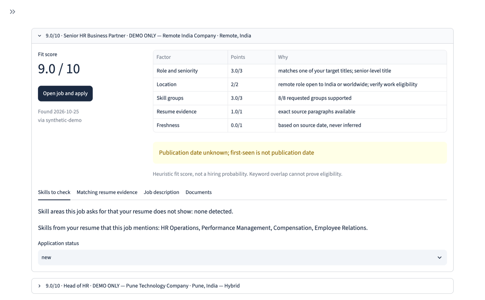
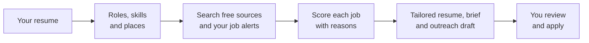

<p align="center">
  
</p>

<h1 align="center">Job Search Desk</h1>

<p align="center">
  <b>Find jobs that fit, and see exactly why.</b><br>
  A free, local-first job search for any career, anywhere. It explains every fit score<br>
  and tailors your real resume without inventing a single word.
</p>

<p align="center">
  <a href="https://github.com/Shazankk/job-search-desk/actions/workflows/tests.yml"></a>
  <a href="LICENSE"></a>
  
  
  
</p>

<p align="center">
  <a href="https://shazankk.github.io/job-search-desk/"><b>Website</b></a> &nbsp;&nbsp;
  <a href="https://github.com/Shazankk/job-search-desk/archive/refs/heads/main.zip"><b>Download for Mac</b></a> &nbsp;&nbsp;
  <a href="#quick-start"><b>Quick start</b></a> &nbsp;&nbsp;
  <a href="docs/SOURCES.md"><b>Sources</b></a> &nbsp;&nbsp;
  <a href="CONTRIBUTING.md"><b>Contributing</b></a>
</p>

<p align="center">
  
</p>

## Why it's different

Most job tools either spray applications for you or rewrite your resume with an AI that can invent experience. Job Search Desk does neither.

| | Auto-apply bots | AI resume writers | **Job Search Desk** |
|---|:---:|:---:|:---:|
| Writes things you never did | Sometimes | Often | **Never** |
| Applies or messages without you | Yes | No | **Never** |
| Explains why a job fits | No | Rarely | **Every score, line by line** |
| Your resume and history stay on your computer | No | No | **Yes** |
| Cost | Subscription | Subscription | **Free and open source** |

- **Factual tailoring.** It only reorders your real resume paragraphs. `resume-provenance.json` records every paragraph ID and a source-text hash, so you can prove nothing was changed.
- **Explainable scores.** Every score lists its points, deductions (wrong experience level, unfamiliar sector) and the skills you don't show.
- **Any career, anywhere.** Type places however you like (`pune`, `LONDON`, `bangalore`), pick on-site, hybrid or remote, and it recognises 16 career fields from your resume.
- **Free by default.** The default sources need no account or API key. AI is optional and only ever reorders what you wrote.

## How it works



## What it does

- Runs on your computer as a small dashboard at http://127.0.0.1:8501.
- Finds openings from free sources, your job-alert emails, employer watchlists and manual imports.
- Scores jobs out of 10, with reasons, deductions and missing skills, and hides reposts and duplicates.
- Prepares a tailored Word resume, a job brief, contact-research notes and an outreach draft, filed by date.
- Shows which skills your matching jobs keep asking for that your resume doesn't show.
- Keeps your job history and documents locally. You review everything and apply yourself.

## Quick start

### macOS

You need Python 3.11 or newer and internet access for setup. See [START_HERE.txt](START_HERE.txt) for a step-by-step Mac guide.

1. Download and extract the repository into a permanent folder, or clone it:

   ```sh
   git clone https://github.com/Shazankk/job-search-desk.git
   cd job-search-desk
   ```
2. Double-click **SETUP.command**. It installs dependencies into `.venv` and opens the dashboard.
3. In **Resume & settings**, upload your resume as DOCX or paste its text. Set your places and work arrangements.
4. Review **Discovery sources**. LinkedIn public search is optional and off by default.
5. Click **Find & prepare jobs**.
6. Open the prepared documents from the **Jobs** tab. Review the listing, score and documents before applying.
7. Optionally double-click **INSTALL_DAILY.command** for a daily run at 06:30 in your Mac's local time.

The repository includes a fictional resume at `examples/sample-resume.docx` so you can try it immediately. Replace it with yours before using the results for your search. **DEMO.command** runs a separate offline example.

If macOS blocks a `.command` file, right-click it in Finder and choose **Open**. Follow the macOS security prompt for that file.

| Launcher | What it does |
|---|---|
| `SETUP.command` | Installs dependencies and opens the dashboard |
| `OPEN_DASHBOARD.command` | Opens or restarts the dashboard; safe to click again |
| `STOP_DASHBOARD.command` | Stops the dashboard |
| `RUN_NOW.command` | Runs enabled sources and the optional configured digest |
| `DEMO.command` | Runs the offline example |
| `INSTALL_DAILY.command` / `UNINSTALL_DAILY.command` | Installs or removes the daily launchd schedule |
| `CREDENTIALS.command` | Stores optional secrets in macOS Keychain |
| `IMPORT_OLD_PROJECT.command` | Imports settings and local history from an older project folder |

The launcher normally uses port 8501. If another app uses it, check the Terminal window for the chosen local address. Keep the project folder in place after scheduling. Reinstall the schedule if you move it. A scheduled run needs a logged-in Mac; it cannot run while the computer is powered off.

### Other systems: manual setup

Windows and Linux are untested. The launchers and Keychain integration are macOS-only. The runner currently imports Unix-only `fcntl`, so Windows may need code changes as well as different commands. Use environment variables for secrets outside macOS.

With Python 3.11 or newer, open a terminal in the project folder:

```sh
python3 -m venv .venv
source .venv/bin/activate
python -m pip install -r requirements.txt
python -m streamlit run dashboard.py --server.address 127.0.0.1
```

These are Unix shell commands. On Windows, creating an environment usually uses `py -3 -m venv .venv` and PowerShell activation uses `.venv\Scripts\Activate.ps1`; the compatibility limit above still applies.

After opening the dashboard, follow steps 3–6 above. In another terminal with the environment activated, these commands are also available:

```sh
python -m job_search_desk.runner check
python -m job_search_desk.runner demo
python -m job_search_desk.runner run
python -m job_search_desk.runner prepare
```

`run` discovers and prepares jobs. `prepare` uses saved jobs. Either can send the optional digest when configured; add `--no-email` to suppress it.

## Using it

### Places, work arrangements and careers

Type places in ordinary spellings or capitals: `pune`, `LONDON`, `bangalore` or `Germany`. An offline list recognises about 97 countries and 630 cities, including common aliases. It cannot recognise every spelling or town. If a town is unknown, the dashboard asks for its country.

Choose **On-site**, **Hybrid** or **Remote** with the buttons. Remote means roles open to your country. Check each employer's work eligibility and timezone requirements yourself.

The resume sets suggested titles, skills and career fields automatically: HR, software, data, product, project, finance, marketing, sales, design, operations, customer support, security, healthcare, education, legal and engineering. Other careers fall back to the skills listed on the resume. Review the suggestions before searching. Replacing a resume keeps your location and source preferences.

### Discovery sources

| Source | Coverage and setup | Limits |
|---|---|---|
| LinkedIn public search | Optional; **off by default**. Enable in Discovery sources. No login or key. Also completes LinkedIn leads from alert emails. | Unofficial. LinkedIn's terms prohibit scraping. Defaults: 5 searches and 15 descriptions per run, 50 requests/day, 24-hour cache, 3-second spacing. Pauses for 24 hours if blocked. Access can stop. |
| Naukri sitemaps | Places in India. Reads published job sitemaps allowed for generic clients by its robots.txt. Filters target titles and experience. | Descriptions are unavailable through this source. Open the listing and paste the full description. |
| Himalayas | Free remote-jobs API, filtered to roles open to your country. No account or key. | Remote roles only; check country and timezone restrictions. |
| Adzuna | Optional free API key; city search in 19 supported countries. | Not every country is supported. Leads need full descriptions pasted. Quotas and account terms apply. |
| Your job-alert emails | Upload `.eml` files or enable read-only IMAP for alerts from any portal. | Email formats vary. Some links or details need manual import. You create portal alerts yourself. |
| Employer watchlists | Public Greenhouse, Lever and Ashby boards; RSS/Atom feeds are also supported. | You supply board/feed details. These cover watched employers only. |
| Manual import | Add a listing and its full description yourself. | Verify its source and whether it is still open. |

See [source details and limits](docs/SOURCES.md). Leads with incomplete descriptions need review before documents can be prepared. **Prepare saved jobs** prepares completed listings without a new discovery run. Reposts and cross-source copies are hidden as duplicates; duplicate detection is approximate.

### Understanding a score

| Factor | Maximum points |
|---|---:|
| Title/career and seniority | 3 |
| Location and work arrangement | 2 |
| Skill coverage | 3 |
| Resume evidence | 1 |
| Freshness | 1 |

After these points, the score loses 1.5 if the minimum experience requested is more than two years above yours. It loses 1 if the maximum is more than six years below yours, and 1 if a detected sector has no match in your resume.

Scores are capped at 3 for other careers, 4 for junior titles against a senior profile, and 5 for unconfirmed or outside-target locations. Missing technology named in a technical title can cap a score at 6. Incomplete leads are capped at 4. Thin descriptions cannot earn full skill credit. The brief explains deductions and gaps.

This is a keyword heuristic, not hiring odds. A high score does not prove you meet every requirement. The Jobs score slider filters the view; the document preparation threshold is a separate setting.

### Your documents

Prepared documents appear in:

```text
artifacts/<date first found>/<Company - Job title [id]>/
  tailored-resume.docx
  brief.md
  contacts.md
  outreach.md
  job.json
  resume-provenance.json
```

The date is when the job was first found, in local time. Rebuilding documents keeps that date. Use **Open prepared documents folder** in Jobs to find them.

Resume paragraphs stay factual and verbatim; only their permitted ordering changes. Contact notes provide research guidance when no contact is verified. They do not guess names or email addresses. Outreach remains a draft for you to review and send yourself.

### Skills gap panel

The **Jobs** tab shows skill areas requested by your matching jobs that your resume does not show. Use it to review missing evidence or plan learning. A missing keyword does not prove you lack a skill. Add resume content only when it is true.

### Optional digest and paragraph ordering

An optional SMTP digest sends updates to your chosen email address. Configure SMTP in advanced settings and store `SMTP_PASSWORD` in Keychain or an environment variable. Enable it explicitly. It sends no employer outreach.

In **AI connection**, choose OpenAI or Claude, enter an API model and key, and enable the consent switch if you want paragraph ordering. API charges may apply. Local ordering works without a key and remains the fallback.

## Privacy

Job history is stored in SQLite under `data/`. Resumes, settings, caches, logs and prepared documents also stay in the project folder. Local files are not encrypted by the app. Keep the folder private and choose backups or cloud sync deliberately.

Secrets belong in macOS Keychain or environment variables, not settings files or commits. Supported variable names are `OPENAI_API_KEY`, `ANTHROPIC_API_KEY`, `ADZUNA_APP_ID`, `ADZUNA_APP_KEY`, `IMAP_PASSWORD` and `SMTP_PASSWORD`.

The dashboard binds only to `127.0.0.1`. Search requests carry role and place, never your resume; providers also see your network address. Optional AI shares job text and resume paragraphs only when enabled with consent. Optional IMAP reads the configured mailbox folder; SMTP sends the configured digest. Review those services' policies before enabling them.

## Limitations

- Coverage is partial. No source finds every opening, and access can change or fail.
- LinkedIn public access can stop. Its terms prohibit scraping even without login.
- Naukri and Adzuna leads need full descriptions pasted.
- Scoring, sector checks and experience checks are heuristics. Review qualifications, work authorisation and listing details yourself.
- Email layouts vary. OAuth-only or administrator-restricted mailboxes may not work.
- There is no salary filter.
- Launchers are macOS-only. Windows and Linux have not been validated.
- No jobs, interviews or ATS ranking are promised.

Check **Activity** and `logs/agent.log` when a source fails. A source error does not mean there are no jobs. See [validation scope](docs/VALIDATION.md) for checks that need a live environment.

## Development and contributing

The code lives in `job_search_desk/`. With your virtual environment activated:

```sh
python -m pip install -r requirements-dev.txt
python -m pytest tests -q
```

Tests must stay offline. `tests/conftest.py` blocks real network requests. GitHub Actions runs the suite on macOS with Python 3.12.

Contributions are welcome, especially new sources, more career families and places, and Windows/Linux launchers. New sources need a terms and robots.txt check. No login scraping or CAPTCHA bypass. See [CONTRIBUTING.md](CONTRIBUTING.md).

## Licence and credits

Job Search Desk is available under the [MIT licence](LICENSE).

The LinkedIn guest-search workflow is adapted from the MIT-licensed ai-job-search-india project. See [THIRD_PARTY_NOTICES.md](THIRD_PARTY_NOTICES.md) for attribution and the third-party licence.

If Job Search Desk helps your search, a star on GitHub helps other job seekers find it.
